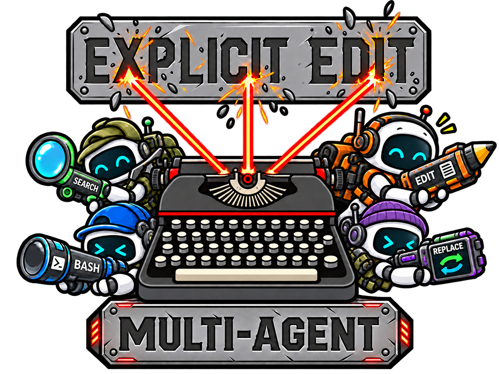

<p align="center">
  
</p>

<h1 align="center">Explicit Edit Benchmark: Multi-Agent</h1>

<p align="center">One file. 22,743 lines. A team of 15 agents editing the same project concurrently.</p>

<p align="center">
  <a href="https://github.com/alexshpunt/explicit-edit-benchmark/actions/workflows/ci.yml"></a>
  <a href="./LICENSE"></a>
  <a href="https://huggingface.co/datasets/alexshpunt/explicit-edit-benchmark"></a>
  <a href="https://huggingface.co/spaces/alexshpunt/benchmark-explorer?filter.benchmark=explicit-edit-multi-agent"></a>
</p>

<!-- benchmark-badges:explicit-edit-multi-agent:start -->
<p align="center">
  <a href="https://huggingface.co/spaces/alexshpunt/benchmark-explorer?filter.benchmark=explicit-edit-multi-agent"></a>
  <a href="https://huggingface.co/spaces/alexshpunt/benchmark-explorer?filter.benchmark=explicit-edit-multi-agent"></a>
  <a href="https://huggingface.co/spaces/alexshpunt/benchmark-explorer?filter.benchmark=explicit-edit-multi-agent"></a>
  <a href="https://huggingface.co/spaces/alexshpunt/benchmark-explorer?filter.benchmark=explicit-edit-multi-agent"></a>
  <a href="https://huggingface.co/spaces/alexshpunt/benchmark-explorer?filter.benchmark=explicit-edit-multi-agent"></a>
  <a href="https://huggingface.co/spaces/alexshpunt/benchmark-explorer?filter.benchmark=explicit-edit-multi-agent"></a>
  <a href="https://huggingface.co/spaces/alexshpunt/benchmark-explorer?filter.benchmark=explicit-edit-multi-agent"></a>
</p>
<!-- benchmark-badges:explicit-edit-multi-agent:end -->

Multi Edit ([Explicit Edit — Multi-Agent](docs/multi-agent.md),
`explicit-edit-multi-agent`) tests whether agents can make precise, atomic edits
and leave the product working, even while other agents change the same code.
Each requested edit is feasible and checked with a scripted reference engine.
A dependency graph fixes the 28 barriers. Within each barrier, atomic edits are
split evenly across the team, with dependent chains kept together. Small barriers
use fewer agents; barriers are not merged just to fill the team.

### Methodology

We take pinned C++ source from [Yocto/GL](https://github.com/xelatihy/yocto-gl),
prepare a comment-free project, pack its modules into one monolith, shuffle
function definitions and rename declarations and their bound uses. Agents must
restore that prepared project through **71 restoration tasks**: refactor the
monolith into working headers and implementation files and restore the names.
They must preserve function bodies, literals, macros, inactive branches and
previously accepted edits. See the [source provenance and licenses](fixtures/explicit-edit-multi-agent/PROVENANCE.md).

The 15 agents share one live workspace and keep separate histories. Each gets a
queue of bounded messages. A scripted reference engine must pass the full parallel schedule on the first
check of every barrier before measured agents start. Reference runs stop at the
first failed barrier and cannot use correction passes. Verification runs only at barriers:
Clang 18 symbol identities and protected source must match the expected snapshot,
a fresh build must pass, and two scenes rendered twice must match the original
pixels exactly. Function and declaration order within a file does not matter.

A failed round allows five corrections without resetting the source or agent
histories. Corrections describe current problems using compiler facts and
already-public requirements, not replayed tasks. They are split across the whole
team without executor attribution. **Score is the percentage of all 71 tasks jointly accepted.** Local
runs have no overall or per-delivery deadline. Preparation is model-free but
CPU-heavy; read the [run guide](docs/multi-agent.md) before starting.

<p align="center">
  
</p>

<h1 align="center">Explicit Edit Benchmark</h1>

<p align="center">Exact text changes across 226 deterministic editing tasks.</p>

<p align="center">
  <a href="https://github.com/alexshpunt/explicit-edit-benchmark/actions/workflows/ci.yml"></a>
  <a href="./LICENSE"></a>
  <a href="https://huggingface.co/datasets/alexshpunt/explicit-edit-benchmark"></a>
  <a href="https://huggingface.co/spaces/alexshpunt/benchmark-explorer?filter.benchmark=explicit-edit%2Fexplicit-edit"></a>
</p>

<!-- benchmark-badges:explicit-edit/explicit-edit:start -->
<p align="center">
  <a href="https://huggingface.co/spaces/alexshpunt/benchmark-explorer?filter.benchmark=explicit-edit%2Fexplicit-edit"></a>
  <a href="https://huggingface.co/spaces/alexshpunt/benchmark-explorer?filter.benchmark=explicit-edit%2Fexplicit-edit"></a>
  <a href="https://huggingface.co/spaces/alexshpunt/benchmark-explorer?filter.benchmark=explicit-edit%2Fexplicit-edit"></a>
  <a href="https://huggingface.co/spaces/alexshpunt/benchmark-explorer?filter.benchmark=explicit-edit%2Fexplicit-edit"></a>
  <a href="https://huggingface.co/spaces/alexshpunt/benchmark-explorer?filter.benchmark=explicit-edit%2Fexplicit-edit"></a>
  <a href="https://huggingface.co/spaces/alexshpunt/benchmark-explorer?filter.benchmark=explicit-edit%2Fexplicit-edit"></a>
  <a href="https://huggingface.co/spaces/alexshpunt/benchmark-explorer?filter.benchmark=explicit-edit%2Fexplicit-edit"></a>
</p>
<!-- benchmark-badges:explicit-edit/explicit-edit:end -->

Explicit Edit (`explicit-edit`) is an open benchmark for measuring how accurately
coding agents and agent harnesses edit files across **226 deterministic,
byte-exact tasks**.

The tasks are small on purpose. None of them needs deep reasoning or domain knowledge: the agent finds the right text, changes it, and leaves every other byte as it was. That keeps the attention on what actually differs between setups, which is the model, the tools, and the harness around them.

There are 226 of them: replacements, insertions, deletions, copies, moves, large files, several file types, and Unicode edge cases. A verifier compares the result byte for byte.

**What the tasks actually are:** [Benchmark tasks](docs/tasks.md) lists every task family, explains what each scale means, and shows how the generator increases context, matches, files, decoys, block size, and Unicode risk. The original [methodology and Score](docs/methodology.md) stay unchanged.

## Shared setup and results

Both suites use the same CLI, harness adapters, model configuration, normalized
statistics and publication path. Their Scores and rankings stay separate: a
percentage from one suite is not interchangeable with a percentage from the other.
Omitting `--suite` still selects Explicit Edit 1.0.

Each badge block counts only that benchmark's published data. `suites` counts
published benchmark versions; `contributors` counts attributed Dataset submitters.
The scheduled Dataset-to-README sync refreshes both blocks; unpublished benchmarks
stay at zero.

Results live in the [Benchmark Explorer](https://huggingface.co/spaces/alexshpunt/benchmark-explorer)
and the [Hugging Face Dataset](https://huggingface.co/datasets/alexshpunt/explicit-edit-benchmark).
Run either suite with your own model and harness, then share the observation.
New task ideas and harness contributions are welcome.

<!-- benchmark-community:start -->

## Data contributors

Thank you to everyone who shares benchmark observations. Your work makes this public comparison possible.

| Contributor                                                | Accepted runs | Configurations |
| ---------------------------------------------------------- | ------------: | -------------: |
| [@ashokkumards](https://huggingface.co/ashokkumards)       |             1 |              1 |
| [@TreyThomasCodes](https://huggingface.co/TreyThomasCodes) |             7 |              7 |
| [@user2221](https://huggingface.co/user2221)               |             5 |              5 |
| [@xuankunv1](https://huggingface.co/xuankunv1)             |             4 |              4 |
| [@Yugimob](https://huggingface.co/Yugimob)                 |            11 |             11 |

## Accepted harnesses

| Harness                                                                                                                                                  | Accepted runs | Configurations |
| -------------------------------------------------------------------------------------------------------------------------------------------------------- | ------------: | -------------: |
| [`anchor-edit`](https://huggingface.co/spaces/alexshpunt/benchmark-explorer?card=harness%3Aanchor-edit%40latest)                                         |             1 |              1 |
| [`baseline-agent`](https://huggingface.co/spaces/alexshpunt/benchmark-explorer?card=harness%3Abaseline-agent%40latest)                                   |             6 |              5 |
| [`bb`](https://huggingface.co/spaces/alexshpunt/benchmark-explorer?card=harness%3Abb%40latest)                                                           |             7 |              7 |
| [`codex-cli-default`](https://huggingface.co/spaces/alexshpunt/benchmark-explorer?card=harness%3Acodex-cli-default%40latest)                             |             2 |              6 |
| [`d3ara1n-pi-hashline-edit`](https://huggingface.co/spaces/alexshpunt/benchmark-explorer?card=harness%3Ad3ara1n-pi-hashline-edit%40latest)               |             1 |              1 |
| [`dsh-code`](https://huggingface.co/spaces/alexshpunt/benchmark-explorer?card=harness%3Adsh-code%40latest)                                               |             2 |              6 |
| [`dsh-standard`](https://huggingface.co/spaces/alexshpunt/benchmark-explorer?card=harness%3Adsh-standard%40latest)                                       |             2 |              6 |
| [`github-copilot-cli-default`](https://huggingface.co/spaces/alexshpunt/benchmark-explorer?card=harness%3Agithub-copilot-cli-default%40latest)           |             2 |              6 |
| [`jerryan-pi-hashline-edit`](https://huggingface.co/spaces/alexshpunt/benchmark-explorer?card=harness%3Ajerryan-pi-hashline-edit%40latest)               |             1 |              1 |
| [`oh-my-pi-default`](https://huggingface.co/spaces/alexshpunt/benchmark-explorer?card=harness%3Aoh-my-pi-default%40latest)                               |             3 |              7 |
| [`opencode-default`](https://huggingface.co/spaces/alexshpunt/benchmark-explorer?card=harness%3Aopencode-default%40latest)                               |             2 |              6 |
| [`personal-pi-extensions-opencode`](https://huggingface.co/spaces/alexshpunt/benchmark-explorer?card=harness%3Apersonal-pi-extensions-opencode%40latest) |             1 |              1 |
| [`pi-agent-ide`](https://huggingface.co/spaces/alexshpunt/benchmark-explorer?card=harness%3Api-agent-ide%40latest)                                       |            26 |             28 |
| [`pi-apply-patch`](https://huggingface.co/spaces/alexshpunt/benchmark-explorer?card=harness%3Api-apply-patch%40latest)                                   |             1 |              1 |
| [`pi-better-edit`](https://huggingface.co/spaces/alexshpunt/benchmark-explorer?card=harness%3Api-better-edit%40latest)                                   |             5 |              5 |
| [`pi-better-read-edit`](https://huggingface.co/spaces/alexshpunt/benchmark-explorer?card=harness%3Api-better-read-edit%40latest)                         |             1 |              1 |
| [`pi-codex-conversion`](https://huggingface.co/spaces/alexshpunt/benchmark-explorer?card=harness%3Api-codex-conversion%40latest)                         |             1 |              1 |
| [`pi-codex-edit`](https://huggingface.co/spaces/alexshpunt/benchmark-explorer?card=harness%3Api-codex-edit%40latest)                                     |             1 |              1 |
| [`pi-codex-minimal-tools`](https://huggingface.co/spaces/alexshpunt/benchmark-explorer?card=harness%3Api-codex-minimal-tools%40latest)                   |             1 |              1 |
| [`pi-codex-tools`](https://huggingface.co/spaces/alexshpunt/benchmark-explorer?card=harness%3Api-codex-tools%40latest)                                   |             1 |              1 |
| [`pi-default`](https://huggingface.co/spaces/alexshpunt/benchmark-explorer?card=harness%3Api-default%40latest)                                           |            17 |             12 |
| [`pi-edit-safe`](https://huggingface.co/spaces/alexshpunt/benchmark-explorer?card=harness%3Api-edit-safe%40latest)                                       |             1 |              1 |
| [`pi-hash-anchored-edit`](https://huggingface.co/spaces/alexshpunt/benchmark-explorer?card=harness%3Api-hash-anchored-edit%40latest)                     |             1 |              1 |
| [`pi-hash-edit`](https://huggingface.co/spaces/alexshpunt/benchmark-explorer?card=harness%3Api-hash-edit%40latest)                                       |             1 |              1 |
| [`pi-hashline-context-edit`](https://huggingface.co/spaces/alexshpunt/benchmark-explorer?card=harness%3Api-hashline-context-edit%40latest)               |             1 |              1 |
| [`pi-hashline-edit`](https://huggingface.co/spaces/alexshpunt/benchmark-explorer?card=harness%3Api-hashline-edit%40latest)                               |             1 |              1 |
| [`pi-hashline-edit-pro`](https://huggingface.co/spaces/alexshpunt/benchmark-explorer?card=harness%3Api-hashline-edit-pro%40latest)                       |            12 |             12 |
| [`pi-hledit`](https://huggingface.co/spaces/alexshpunt/benchmark-explorer?card=harness%3Api-hledit%40latest)                                             |             1 |              1 |
| [`pi-lean-edit`](https://huggingface.co/spaces/alexshpunt/benchmark-explorer?card=harness%3Api-lean-edit%40latest)                                       |             1 |              1 |
| [`pi-lector`](https://huggingface.co/spaces/alexshpunt/benchmark-explorer?card=harness%3Api-lector%40latest)                                             |             1 |              1 |
| [`pi-mono-multi-edit`](https://huggingface.co/spaces/alexshpunt/benchmark-explorer?card=harness%3Api-mono-multi-edit%40latest)                           |             1 |              1 |
| [`pi-openai-codex-compat`](https://huggingface.co/spaces/alexshpunt/benchmark-explorer?card=harness%3Api-openai-codex-compat%40latest)                   |             1 |              1 |
| [`pi-semantic-edit`](https://huggingface.co/spaces/alexshpunt/benchmark-explorer?card=harness%3Api-semantic-edit%40latest)                               |             1 |              1 |
| [`pi-str-replace-editor`](https://huggingface.co/spaces/alexshpunt/benchmark-explorer?card=harness%3Api-str-replace-editor%40latest)                     |             1 |              1 |
| [`pi-wayfinder`](https://huggingface.co/spaces/alexshpunt/benchmark-explorer?card=harness%3Api-wayfinder%40latest)                                       |             1 |              1 |

<!-- benchmark-community:end -->

## What you need

- Linux or WSL2
- Node.js 24 or newer
- Python 3
- Bubblewrap (`bwrap`)
- the agent CLI you want to test, installed and logged in
- access to the model you want to test
- for Multi-Agent: Linux x64 or x64 WSL2, Clang 18 as `clang++`, Clangd,
  libclang 18 with its official Python bindings (`python3-clang-18` on Ubuntu),
  and the C++17 standard library
- a free [Hugging Face account](https://huggingface.co/join) to submit the result

Clone the repository, then install it and the Hugging Face CLI:

```sh
git clone https://github.com/alexshpunt/explicit-edit-benchmark.git
cd explicit-edit-benchmark
npm ci
python3 -m pip install --upgrade huggingface_hub
hf auth login
```

## Pick your agent

The benchmark has ready adapters for these CLIs. Use the name in the `--harness` flag.

| `--harness`                  | Runs                                                                                                                | Binary     |
| ---------------------------- | ------------------------------------------------------------------------------------------------------------------- | ---------- |
| `pi-default`                 | [Pi](https://pi.dev/)                                                                                               | `pi`       |
| `baseline-agent`             | Pi with bash only and an empty system prompt                                                                        | `pi`       |
| `pi-agent-ide`               | [Pi Agent IDE](https://github.com/alexshpunt/pi-agent-ide)                                                          | `pi`       |
| `codex-cli-default`          | [Codex CLI](https://github.com/openai/codex)                                                                        | `codex`    |
| `opencode-default`           | [OpenCode](https://github.com/anomalyco/opencode)                                                                   | `opencode` |
| `oh-my-pi-default`           | [Oh My Pi](https://github.com/can1357/oh-my-pi)                                                                     | `omp`      |
| `github-copilot-cli-default` | [GitHub Copilot CLI](https://docs.github.com/en/copilot/how-tos/copilot-cli/set-up-copilot-cli/install-copilot-cli) | `copilot`  |
| `dsh-standard`               | [DeepSeek Harness](https://github.com/deepseek-ai/deepseek-harness), native tools                                   | `dsh`      |
| `dsh-code`                   | [DeepSeek Harness](https://github.com/deepseek-ai/deepseek-harness), code mode                                      | `dsh`      |

The name in the flag is the published harness family, so a result lands in the leaderboard under the name you ran. The binary column is what actually runs; pass a different path with `--command` when yours is not on `PATH`. `pi-default` and `pi-agent-ide` both run `pi`, and differ only in the tools.

You install and sign in to that CLI yourself. Local runs copy explicit credential files into isolated private state; they do not update your original account files. Treat retained run state and logs as sensitive, never as publishable evidence.

For anything not in this list you write your own adapter. [Benchmark automation and public data](docs/benchmark-automation.md) documents the config API, and [examples/bb](examples/bb/benchmark.config.mjs) is a worked example for a harness that is more than one CLI call: it starts a server, runs another agent in a thread, and reads that thread's timeline. We ship the example and a smoke run, not a bb result.

## Run and publish

Choose the suite and whether you want a local or official observation.
**These commands spend model credit and submit a result.** The automatic smoke
check also calls the model. Confirm the scope and account before starting.

### Local observation

Use the same command for either suite:

```sh
# Original suite: all 226 tasks, default concurrency 10
npm run benchmark -- run --local --suite explicit-edit \
  --harness pi-default --model PROVIDER/MODEL --thinking low

# Multi-Agent: all 71 tasks, fixed 15-agent team
npm run benchmark -- run --local --suite explicit-edit-multi-agent \
  --harness pi-default --model PROVIDER/MODEL --thinking high
```

Each selected configuration first passes a one-task model/auth smoke check.
The original suite then runs independent trials. Multi-Agent also prepares the
renderer and proves the parallel schedule with scripted editors before measured
agents start. It allows five corrections per failed barrier, keeps failed edits
and histories, and stops when those corrections are exhausted. Legitimate early
stops retain the accepted prefix; they are results, not runs to hide.

The command exports and validates the common safe bundle, then opens a Dataset
contribution. Local observations are marked `unverified`. Different configurations
in a Multi-Agent matrix run as separate teams, sequentially.

### Official observation

Official mode uses a registered preset and exact installed package versions.
For example, replace `PI_VERSION` with the version you intend to measure:

```sh
npm run benchmark -- run --official --suite explicit-edit \
  --harness pi-default --model PROVIDER/MODEL --thinking low \
  --agent-version PI_VERSION
```

Pi Agent IDE also requires `--harness-version`; Oh My Pi requires
`--runtime-version`. Official mode does not accept custom configs or provider files.

This command checks `gh` and `hf` login, creates a public caller repository if
needed, uploads Pi and Hugging Face credentials as Actions secrets through stdin,
dispatches the workflow, and waits for acceptance. Approve those effects before
running it. Credentials are never placed in command arguments.

**Multi-Agent official activation is pending.** Its producer, policy and caller
updates are prepared, but official runs require deployed approved pins and a
matching suite release. Do not dispatch with older callers. See the
[official release gate](docs/multi-agent.md#official-release-gate).

Approved workflow results are marked `verified`. Both verified and unverified
observations remain visible. Use `--caller-repository OWNER/REPO` for an existing
caller or `--no-wait` to return after dispatch. Original-suite official runs can
select `--task TASK_ID`; Multi-Agent always uses the whole workload.
[Official community runs](docs/official-community-runs.md) explains signing,
acceptance and submit-only recovery.

### Configuration and lower-level commands

| Option                               | Meaning                                                                       |
| ------------------------------------ | ----------------------------------------------------------------------------- |
| `--suite`                            | Which benchmark to run; original Explicit Edit remains the default            |
| `--harness`, `--model`, `--thinking` | The installed harness, exact selector and reasoning level                     |
| `--config FILE`                      | Custom adapter or model × harness matrix, instead of a preset; local only     |
| `--concurrency N`                    | Original-suite parallel trials, default 10; Multi-Agent accepts only 15       |
| `--timeout-seconds N`                | Original-suite local delivery limit, default 120; unavailable for Multi-Agent |

Local provider routes use `--provider-file` and `--env-file`; explicit credential
files use `--auth-file`. Keep those files private.
The [configuration guide](docs/running.md) covers runtime mounts, account routes
and adapter details. The lower-level `benchmark:submit` command accepts
`--suite` too. It applies the selected suite's policy, not one shared deadline
or correction count.

For model-free Multi-Agent preparation, read the [reference commands](docs/multi-agent.md#model-free-preparation-and-proof).
For execution without automatic submission, use the common `raw-run`, `export`
and `inspect` workflow in [development commands](docs/running.md#development-commands).
Never pass an unsupported suite name or bypass readiness to start a run.

## What gets published

The pull request holds benchmark facts: task results, exact versions, timings, tool-call categories, and a safe copy of the configuration recipe. It holds no credentials, local paths, prompts, model prose, raw commands, command output, sessions, or workspaces. Local submission credentials go to the Hub API. Official mode also stores the token in the approved caller's GitHub Actions secrets, as described above.

Keep the failures, timeouts, and recovery attempts in the result, because a published number is only useful when it is the real one. If a row is wrong, fix it at its source and rerun instead of editing the exported file.

## Show your result

Once your run is accepted, you can show its score in your own README:

```md
[](https://huggingface.co/spaces/alexshpunt/benchmark-explorer?card=harness%3Api-agent-ide%40latest)
```

For the original suite, the Dataset publishes one badge per harness family under `badges/`, named after the family. These badges are not Multi-Agent Scores. Clicking a badge opens the latest harness version’s card while keeping the full comparison visible. This is how they look right now:

| Family                       | Badge                                                                                                                                                                                                                                                                                                                      |
| ---------------------------- | -------------------------------------------------------------------------------------------------------------------------------------------------------------------------------------------------------------------------------------------------------------------------------------------------------------------------- |
| `pi-default`                 | [](https://huggingface.co/spaces/alexshpunt/benchmark-explorer?card=harness%3Api-default%40latest)                                 |
| `pi-agent-ide`               | [](https://huggingface.co/spaces/alexshpunt/benchmark-explorer?card=harness%3Api-agent-ide%40latest)                             |
| `codex-cli-default`          | [](https://huggingface.co/spaces/alexshpunt/benchmark-explorer?card=harness%3Acodex-cli-default%40latest)                   |
| `opencode-default`           | [](https://huggingface.co/spaces/alexshpunt/benchmark-explorer?card=harness%3Aopencode-default%40latest)                     |
| `oh-my-pi-default`           | [](https://huggingface.co/spaces/alexshpunt/benchmark-explorer?card=harness%3Aoh-my-pi-default%40latest)                     |
| `github-copilot-cli-default` | [](https://huggingface.co/spaces/alexshpunt/benchmark-explorer?card=harness%3Agithub-copilot-cli-default%40latest) |
| `dsh-standard`               | [](https://huggingface.co/spaces/alexshpunt/benchmark-explorer?card=harness%3Adsh-standard%40latest)                             |
| `dsh-code`                   | [](https://huggingface.co/spaces/alexshpunt/benchmark-explorer?card=harness%3Adsh-code%40latest)                                     |

Each badge shows that family's score across its accepted configurations, on the same scale the Explorer uses. The color follows the score: 90% and up is bright green, then green from 75%, yellow from 50%, orange from 25%, and red below that.

The badge is a small JSON file served by the Dataset, so [shields.io](https://shields.io/badges/endpoint-badge) renders it and it refreshes whenever acceptance rebuilds the Dataset.

## Check the code without spending money

```sh
npm run check
```

It runs formatting, linting, type checks, the unit and integration tests, and one deterministic sandbox trial. It needs no paid model calls or GitHub API access.

CI separately runs `npm run check:pins` to verify trusted commit revisions on GitHub. That online check is not required for local development, renderer preparation or benchmark runs.

## Where to read more

| Document                                                             | What it adds                                                                         |
| -------------------------------------------------------------------- | ------------------------------------------------------------------------------------ |
| [Official community runs](docs/official-community-runs.md)           | GitHub template, verified provenance, automatic acceptance, and submit-only recovery |
| [Configuration guide](docs/running.md)                               | Per-adapter model and auth details, provider routes, mounts, lower-level commands    |
| [Share a result](docs/contributing-results.md)                       | The submission flow step by step, and what happens after you open the pull request   |
| [Benchmark automation and public data](docs/benchmark-automation.md) | The config API, the normalized data format, and the Dataset views                    |
| [Explicit Edit tasks](docs/tasks.md)                                 | Original task families, scales, languages and generation rules                       |
| [Explicit Edit methodology](docs/methodology.md)                     | Original Score, byte-exact verification and recovery                                 |
| [Multi-Agent run guide](docs/multi-agent.md)                         | Shared project, fixed team, dependency graph, preparation and run policy             |
| [Multi-Agent results](docs/multi-agent-results.md)                   | Joint task credit, barrier/participant links and common statistics                   |
| [Architecture](docs/architecture.md)                                 | Shared infrastructure, suite boundaries and accepted evidence                        |

## Skills for coding agents

Public work skills live in `.agents/skills/`. The whole `.pi/` directory is ignored
for personal skills, settings and runtime data. Do not force-add it to Git.

These are instructions that a coding agent loads on its own rather than documents to read.

| Skill                           | The job it covers                                                                                     |
| ------------------------------- | ----------------------------------------------------------------------------------------------------- |
| `configure-codex-account`       | Run Codex on a ChatGPT subscription, an API-key route, or a Chinese provider such as Z.AI or DeepSeek |
| `configure-copilot-account`     | Run Copilot on its own GitHub account, a provider key, or an OAuth-only plan through a local bridge   |
| `add-benchmark-harness`         | Add an adapter for another agent CLI                                                                  |
| `publish-benchmark-observation` | Select a registered suite, configure the run and publish its observation                              |
| `review-benchmark-candidate`    | Review, validate, and accept a contributed result                                                     |
